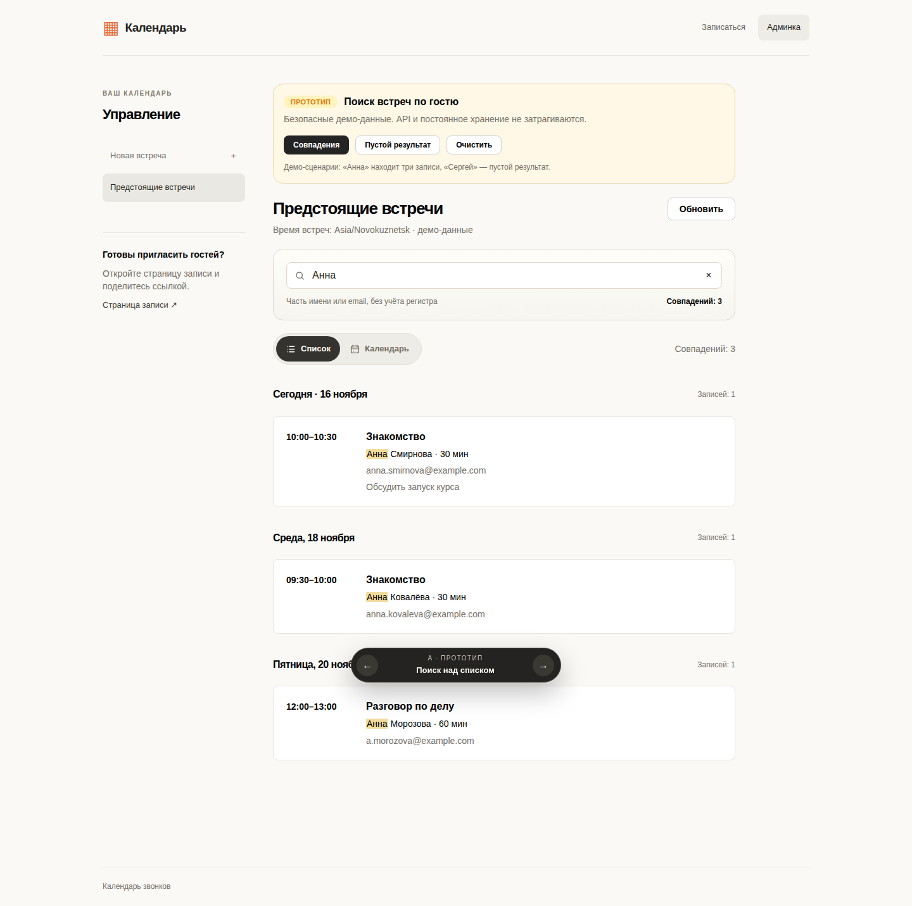
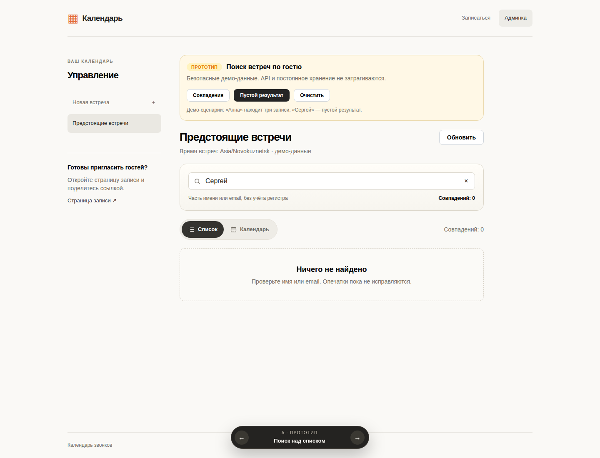
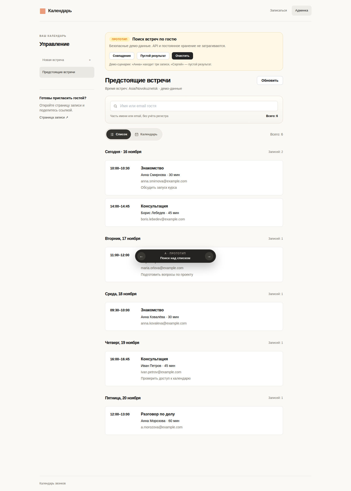
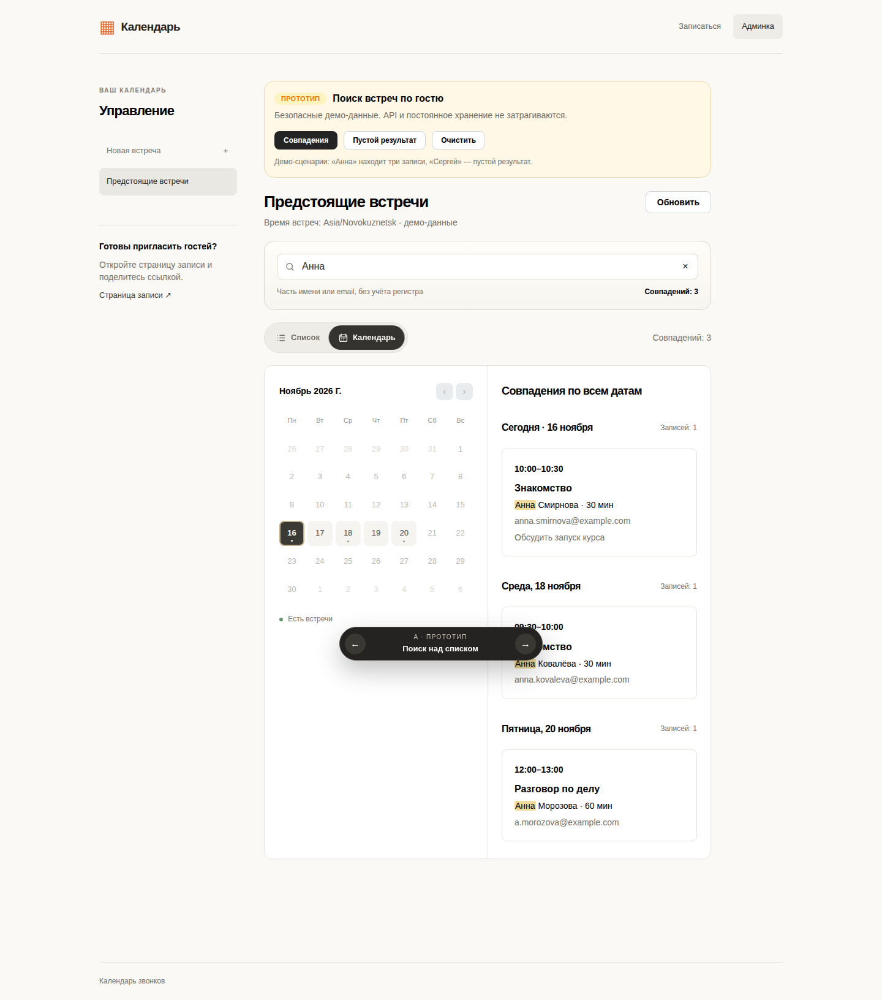
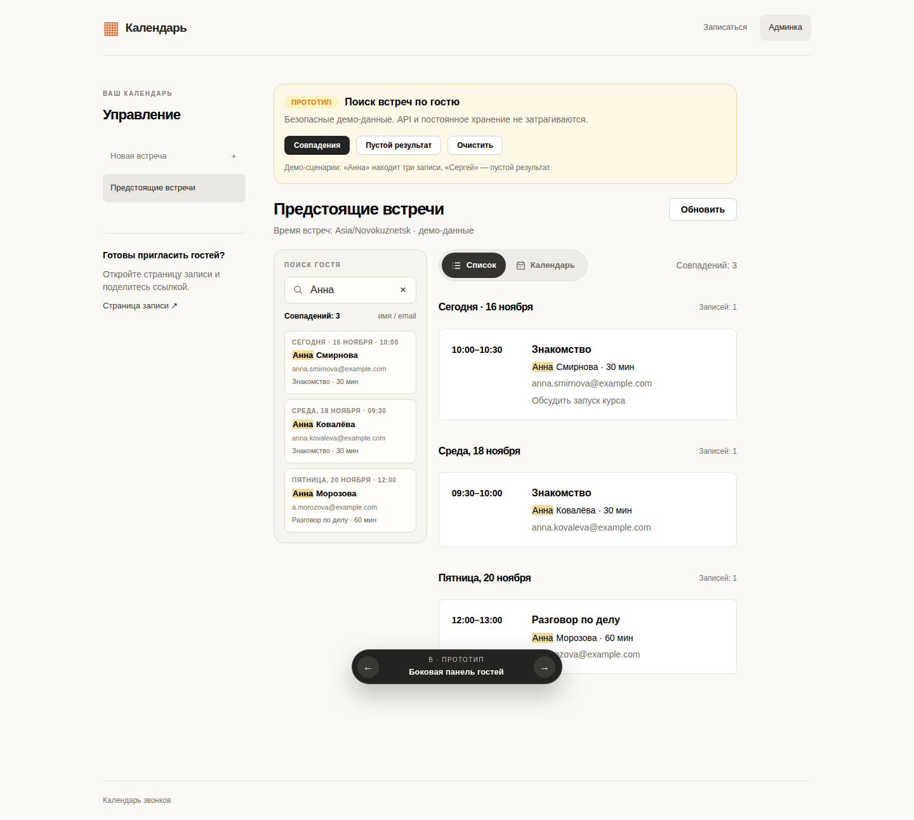
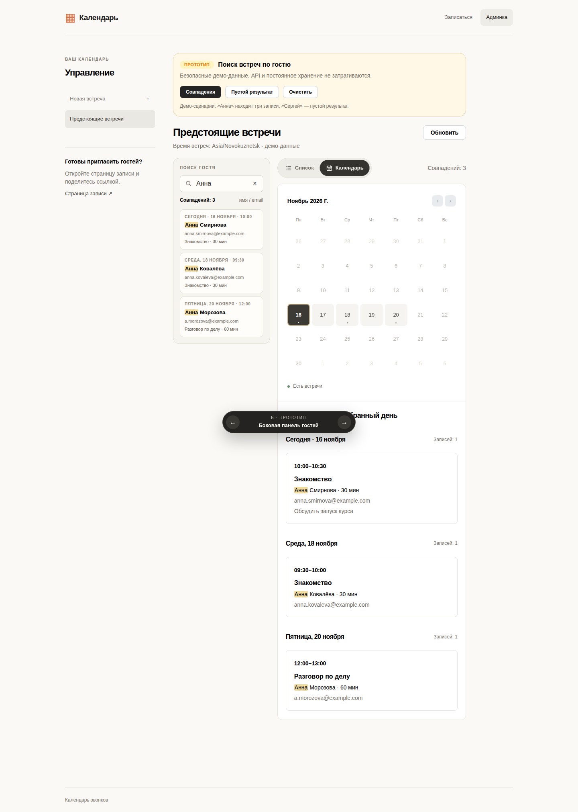
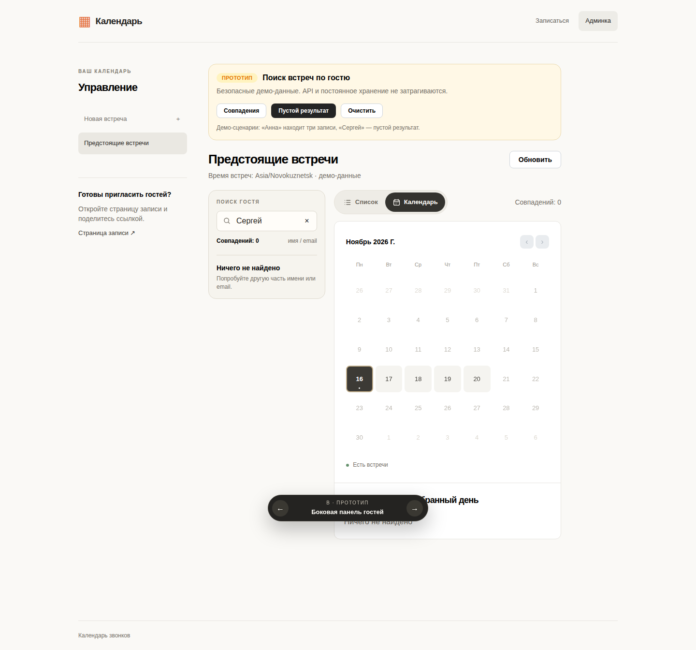
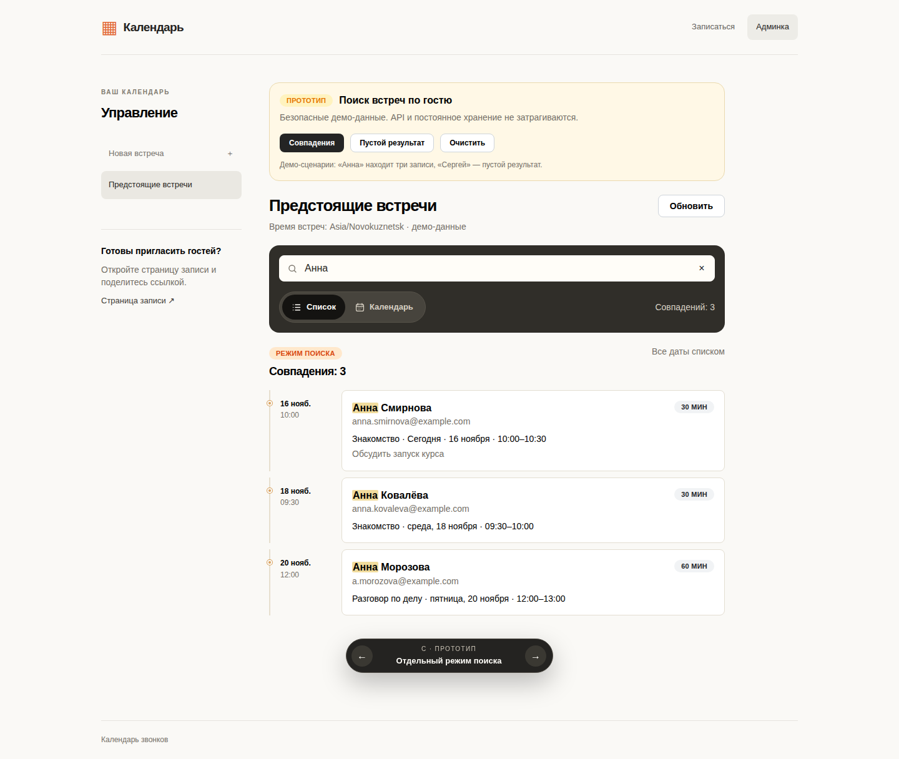
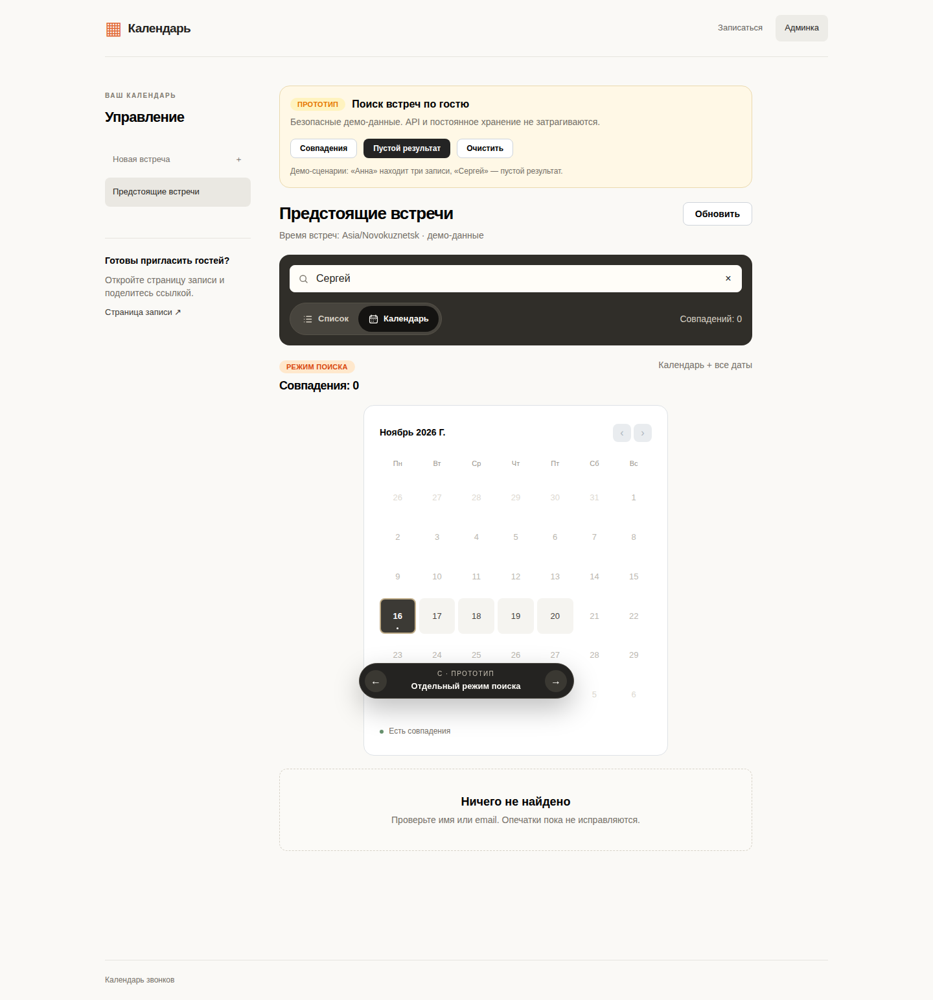
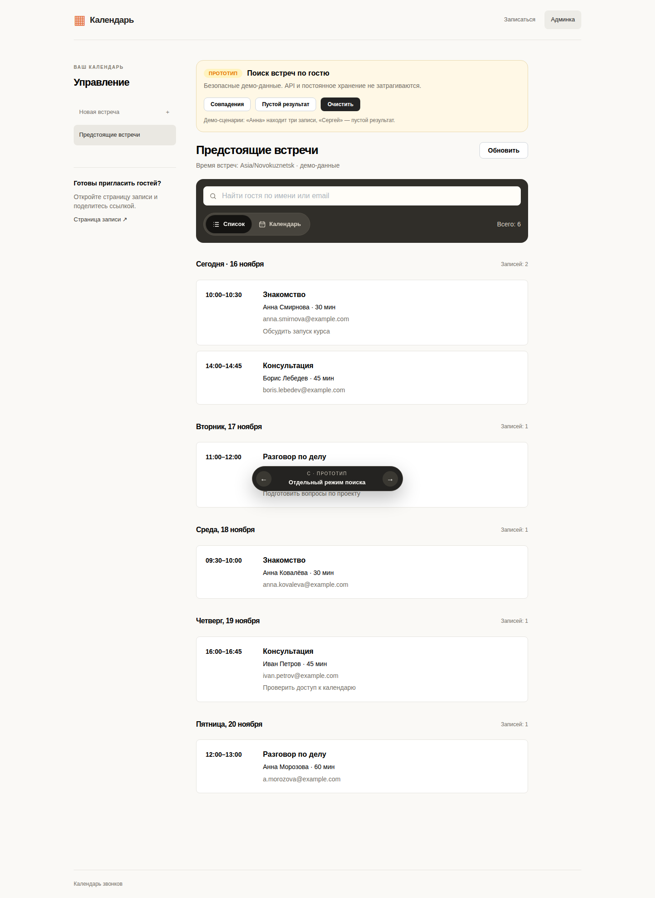

# Макет поиска встреч по гостю (#80)

Статус: **ожидает согласования человеком**. Это throwaway-прототип для выбора компоновки; спецификация, тикеты и реализация не начаты.

## Вопрос макета

Как встроить поиск по части имени или email в существующую страницу «Предстоящие встречи», чтобы он работал и в списке, и в календаре, показывал все совпадения с деталями, давал пустой результат «Ничего не найдено», очищался и сохранял запрос при обновлении списка?

## Запуск

```bash
mise run dev
```

Открывайте варианты на существующем маршруте владельца (`?prototype=search` включает макет, `?variant=` переключает компоновку):

- A — <http://127.0.0.1:5173/admin?view=bookings&prototype=search&variant=a>
- B — <http://127.0.0.1:5173/admin?view=bookings&prototype=search&variant=b>
- C — <http://127.0.0.1:5173/admin?view=bookings&prototype=search&variant=c>

Без `prototype=search` страница остаётся обычной. Внизу экрана — плавающая панель прототипа: стрелки и клавиши `←`/`→` переключают варианты и обновляют URL. Панель скрыта в production-сборке.

## Демо-сценарии

В верхней плашке прототипа есть кнопки:

- **Совпадения** — запрос `Анна`, находит три записи из шести.
- **Пустой результат** — запрос `Сергей`, показывает «Ничего не найдено».
- **Очистить** — пустой запрос, снова показывает все встречи.

Кнопка **Обновить** в шапке варианта имитирует обновление списка: запрос остаётся прежним. Используются только безопасные демо-данные в памяти; API, база и постоянное хранение не затрагиваются. Поиск — по части имени или email без учёта регистра, без исправления опечаток, только по текущим и будущим встречам.

## Варианты

### A. Поиск над списком

Крупное поле поиска над переключателем «Список / Календарь». В списке совпадения сгруппированы по датам, подсветка показывает найденный фрагмент. В календаре отмечаются только даты с совпадениями, а справа выводятся все совпадения по всем датам.









### B. Боковая панель гостей

Слева постоянная панель поиска со списком всех совпадений и деталями; справа — отфильтрованный список или календарь. В режиме календаря панель хранит все совпадения, а повестка дня показывает совпадения на выбранную дату.







### C. Отдельный режим поиска

Компактная панель поиска на тёмном фоне. При вводе запроса страница переходит в отдельный режим: хронологическая лента всех совпадений; в режиме календаря над лентой остаётся календарь с отмеченными датами.








## Что проверить при согласовании

- Какая компоновка ближе: поле над списком, боковая панель или отдельный режим поиска.
- В календаре при активном поиске показывать все совпадения (варианты A и C) или совпадения только на выбранный день, оставив все результаты в боковой панели (вариант B).
- Нужна ли подсветка найденного фрагмента и счётчик совпадений.
- Достаточно ли формулировки «Ничего не найдено» и подсказки про опечатки.

## Проверка

Это повтор этапа макета после timeout запуска 43749027221. Текущий прогон: [Actions run 43750331485](https://github.com/lukyanzhukov/ai-for-developers-project-387/actions/runs/43750331485).

Пройдено: `mise run check` (agents/audit/generate, hk lint+format+workflow, typecheck, build, 34 теста, commitlint). Дополнительно Playwright-проверка подтвердила для всех трёх вариантов поиск без учёта регистра, очистку, пустой результат, сохранение запроса при обновлении, работу в списке и календаре, отсутствие горизонтального переполнения на 1440 и 390 px и переключение клавишами.

После выбора можно собрать один вариант (или взять элементы из нескольких). Прототип хранится вне `main`; реализация начнётся только после отдельного согласования спецификации.
